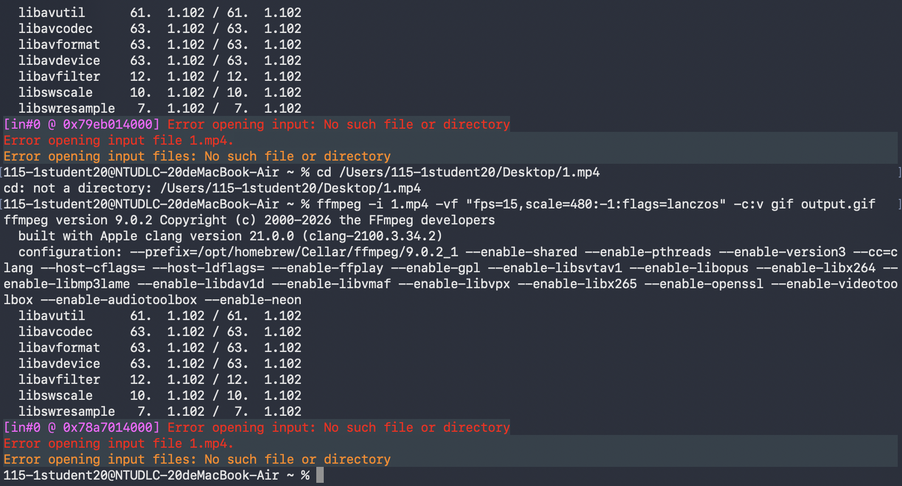
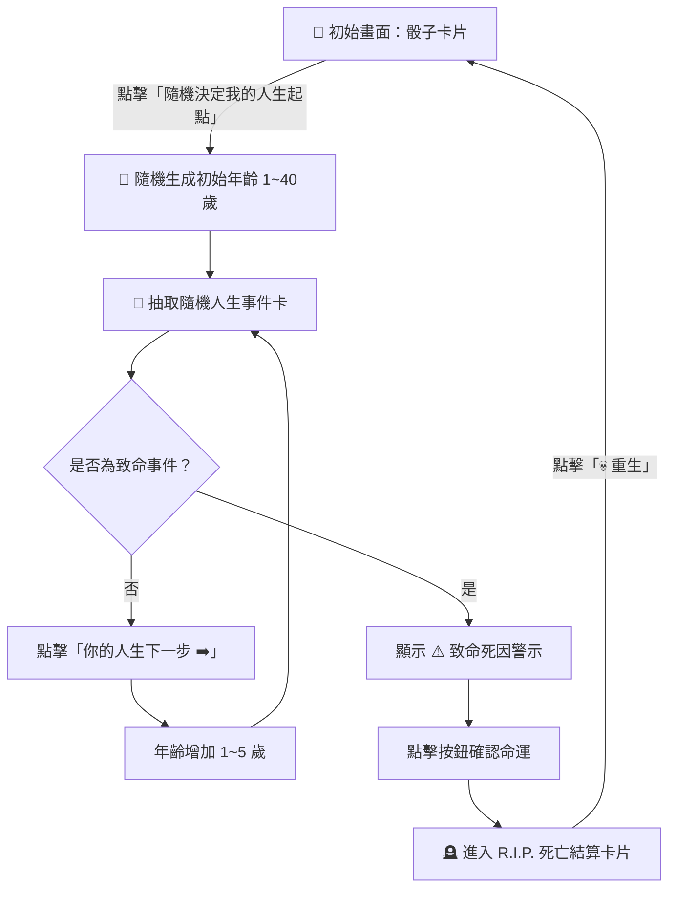

<div align="center">

# 💀 活著算你厲害：荒謬人生模擬器
### *Survive If You Can: Absurd Life Simulator*

<p align="center">
  <a href="#english">🇬🇧 English</a> &nbsp;•&nbsp; <a href="#chinese">🇹🇼 繁體中文</a>
</p>

[](https://swift.org)
[](https://developer.apple.com/xcode/swiftui/)
[](https://developer.apple.com/ios/)
[](https://developer.apple.com/xcode/)
[](LICENSE)
[](https://github.com)

<p align="center">
  <i>"Life is full of unexpected surprises — mostly ridiculous, occasionally fatal."</i><br/>
  <b>一個充滿黑色幽默、無厘頭事件與突發死因的 SwiftUI 隨機人生模擬 App！</b>
</p>

</div>

---

<a id="english"></a>
## 🇬🇧 English

<p align="right"><a href="#chinese">👉 切換至繁體中文</a></p>

### 📱 Preview & Demo

<div align="center">

| 🎬 Live Gameplay Demo | 📸 Absurd Events Overview |
| :---: | :---: |
|  |  |

</div>

---

### 📖 About The Project

**Survive If You Can (活著算你厲害)** is a quirky and humorous iOS game built with **SwiftUI**. 

In this simulation, players step into a completely chaotic journey through life. With every tap, you advance in age and face unpredictable, comical, or deadly random events. Will you live to a ripe old age, or choke on jelly at 48? Will you be struck by lightning, get abducted by aliens, or unexpectedly receive a thousand dollars?

Surviving is an achievement in itself! 🏆

---

### ✨ Key Features

- 🎲 **Random Life Start**: Begin your journey at any unexpected age between 1 and 40.
- ⚡ **Absurd & Hilarious Events**: Encounter meme-worthy events with custom illustrations and matching SF Symbols.
- ⚠️ **Lethal Cause of Death**: High-risk events trigger a death warning badge (`⚠️ 致命死因！`), leading to sudden demise.
- ⚰️ **R.I.P. Settlement Card**: A stylized cemetery tombstone card calculates your final age (`享年 X 歲`) using horror typography (*Creepster*).
- 💀 **Reincarnation System**: Drink Meng Po soup and restart life instantly with one click (`💀 重生`).
- 🎨 **Artistic Typography & Dark Aesthetics**:
  - Cosmic background theme
  - Custom Chinese font: **SweiDevilSansCJKtc-Bold**
  - Horror Western font: **Creepster-Regular**
  - Smooth SwiftUI state transitions (`withAnimation`)

---

### 🛠️ Tech Stack & Highlights

| Technology / Component | Description |
| :--- | :--- |
| **Language** | Swift 5.9+ |
| **UI Framework** | SwiftUI (declarative UI & state-driven rendering) |
| **State Management** | `@State` variables controlling game phase, age, and death state |
| **Icons** | Apple SF Symbols 5 (`cross.case.fill`, `fork.knife`, `bolt.fill`, `tombstone.fill`, etc.) |
| **Custom Fonts** | `SweiDevilSansCJKtc-Bold.ttf` & `Creepster-Regular.ttf` registered via Info.plist |
| **Assets** | Custom meme illustration library bundled in `Assets.xcassets` |

---

### 🎮 How to Play

1. **Roll the Dice**: Tap `🎲 隨機決定我的人生起點` to determine your starting age and draw your initial event.
2. **Advance Life**: Tap `你的整個人生下一步 ➡️` to age 1–5 years and draw the next encounter.
3. **Beware of Fatalities**: If a fatal event appears, brace yourself — your next tap leads straight to the grave!
4. **Reincarnate**: Once deceased (`💀 你已經掛了`), tap `💀 重生` to wipe the slate clean and reincarnate into a brand new destiny!

---

### 📂 Repository Structure

```plaintext
#4-ramdon/
├── #4-ramdon/
│   ├── Assets.xcassets/         # Image sets (memes 1~8, background, colors)
│   ├── ContentView.swift        # Main game UI, event models & game loop logic
│   ├── MyApp.swift              # App entry point (@main)
│   ├── Creepster-Regular.ttf    # Horror font for R.I.P. screen
│   └── SweiDevilSansCJKtc-Bold.ttf # Ghost gothic font for Chinese titles
├── assets/
│   ├── demo.gif                 # Screen recording animation
│   └── screenshot.png           # Multi-device mockup collage
├── -4-ramdon-Info.plist         # Custom font configuration
├── #4-ramdon.xcodeproj          # Xcode project file
└── README.md                    # Project documentation
```

---

### 🚀 Getting Started

1. **Clone the repository**:
   ```bash
   git clone https://github.com/your-username/4-ramdon.git
   ```
2. **Open in Xcode**:
   Double click `#4-ramdon.xcodeproj` or open the directory in Xcode 15+.
3. **Select Run Destination**:
   Choose an iOS 17+ Simulator (e.g., iPhone 15 Pro) or a connected physical device.
4. **Build & Run**:
   Press `Cmd + R` to compile and launch!

---

<br/>

---

<a id="chinese"></a>
## 🇹🇼 繁體中文

<p align="right"><a href="#english">👉 Switch to English</a></p>

### 📱 成果展示與操作預覽

<div align="center">

| 🎬 遊戲操作動態 GIF | 📸 多機型畫面與隨機事件一覽 |
| :---: | :---: |
|  |  |

</div>

---

### 📖 專案簡介

**《活著算你厲害：荒謬人生模擬器》** 是一款使用 **SwiftUI** 開發的趣味黑色幽默人生模擬遊戲。

俗話說「人生無常，大腸包小腸」，在這款遊戲中，玩家的人生每一步都充滿了未知的驚喜（與驚嚇）。只需輕輕一點，歲月便匆匆流逝；你可能莫名其妙走在路上被塞一千塊，也可能躺在床上忽然被外星人抓走。面對各種突如其來的荒謬日常與離奇死因，只要能多活一年，算你厲害！

---

### ✨ 核心特色

- 🎲 **隨機出生起點**：開局直接隨機生成 1～40 歲的人生起跑點，每場命運都完全不同。
- 🤪 **荒誕離奇的隨機事件**：
  - 確診肺炎但順利康復 🏥
  - 吃果凍不小心噎到（卒）🍮
  - 幸運踩到黃金 💩
  - 躺在床上被外星人抓走（卒）👽
  - 惹到雷公被劈到燒焦（卒）⚡️
  - 路上莫名被塞一千塊 💸
  - 肚子劇痛結果只是消化不良 🚽
  - 被扁一拳怒回兩拳 🥊
- ⚠️ **致命死因預警**：抽到死亡事件時立即亮起 `⚠️ 致命死因！` 紅色警示，營造命懸一線的緊張感。
- ⚰️ **專屬 R.I.P. 死亡結算卡**：
  - 結算玩家最終「享年 X 歲（已登出）」。
  - 搭配萬聖恐怖字體 **Creepster** 與墓碑圖示。
  - 幽默提示「請點擊下方『重生』按鈕喝孟婆湯」。
- 💀 **一鍵輪迴重生**：即使掛掉也不用氣餒，點擊 `💀 重生` 即可喝下孟婆湯洗牌重啟荒謬新篇章。
- 🎨 **精緻暗黑宇宙視覺**：
  - 深邃星空背景設計。
  - 特黑趣味鬼體字型 **芫荽鬼體（SweiDevilSansCJKtc-Bold）** 打造吸睛標題。
  - 流暢的 SwiftUI 狀態切換動效 (`withAnimation`)。

---

### 🛠️ 技術實作細節

| 技術模組 | 應用與說明 |
| :--- | :--- |
| **開發語言** | Swift 5.9+ |
| **使用者介面** | SwiftUI 宣告式語法，搭配 `ZStack`、`ScrollView` 與 `VStack` 彈性排版 |
| **資料結構** | `LifeEvent` 結構體遵循 `Identifiable` 協議，包含事件敘述、SF Symbol、自訂圖片與致命判斷 |
| **狀態驅動架構** | `@State private var currentAge`、`gamePhase`、`isDead` 管理遊戲生命週期 |
| **自訂字體整合** | 在 `-4-ramdon-Info.plist` 中配置 `Fonts provided by application`，載入自訂 `.ttf` 字型檔 |
| **防呆機制** | 當角色死亡進入結算階段，前進按鈕自動反灰禁用 (`.disabled(isDead)`)，防止邏輯溢出 |

---

### 🎮 遊玩流程說明



---

### 📂 目錄結構

```plaintext
#4-ramdon/
├── #4-ramdon/
│   ├── Assets.xcassets/         # 圖片素材庫（迷因梗圖 1~8、背景圖、自訂顏色）
│   ├── ContentView.swift        # 核心主畫面、事件資料模型與狀態邏輯
│   ├── MyApp.swift              # App 程式入口點
│   ├── Creepster-Regular.ttf    # 墓碑 R.I.P. 專用英文字體
│   └── SweiDevilSansCJKtc-Bold.ttf # 芫荽鬼體繁體中文字體
├── assets/
│   ├── demo.gif                 # App 實際操作錄影 GIF
│   └── screenshot.png           # 8 款 iPhone 畫面截圖組合圖
├── -4-ramdon-Info.plist         # 專案 Info.plist（字體配置）
├── #4-ramdon.xcodeproj          # Xcode 專案檔
└── README.md                    # 專案說明文件
```

---

### 🚀 如何在本地運行

1. **複製專案庫**：
   ```bash
   git clone https://github.com/your-username/4-ramdon.git
   ```
2. **使用 Xcode 開啟**：
   點擊 `#4-ramdon.xcodeproj` 開啟專案。
3. **選擇目標模擬器**：
   在 Xcode 頂部選擇 iOS 17.0 以上的模擬器（如 iPhone 15 Pro 或 iPhone 16）。
4. **編譯並執行**：
   按下鍵盤快速鍵 `⌘ + R` 即可立即在模擬器或真機上體驗！

---

### 📄 License

This project is licensed under the [MIT License](LICENSE).

---

<div align="center">

Made with ❤️ and humor using **SwiftUI**

⭐ 如果覺得有趣，歡迎給這個專案一顆星星！ ⭐

</div>
